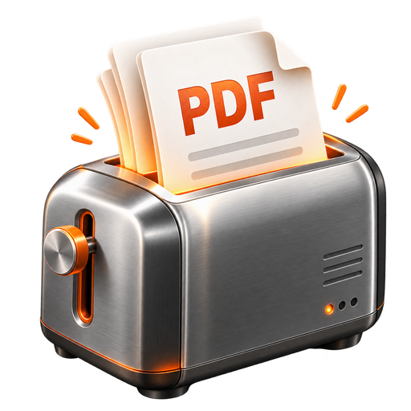
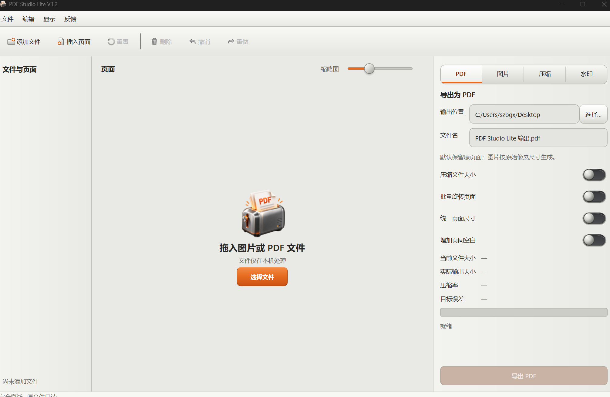

# PDF Studio Lite

<p align="center">
  
</p>

PDF Studio Lite 是一款面向 Windows 11 的完全离线 PDF 工具。轻量、高保真、低损耗、傻瓜式自由编辑拆分重组、去水印，牛逼。

采用拟物风UI设计，致敬老罗，致敬锤子科技。



## 一键下载 Windows 免安装版

**[下载 PDF Studio Lite V3.2（Windows 64 位免安装版）](https://github.com/guoshui0629-star/PDFStudioLite/releases/latest/download/PDF.Studio.Lite.V3.2.Portable.zip)**

**[下载 PDF Studio Lite V3.2（macOS Apple Silicon：M1/M2/M3/M4/M5）](https://github.com/guoshui0629-star/PDFStudioLite/releases/latest/download/PDF.Studio.Lite.V3.2.macOS-Apple-Silicon.dmg)**

**[下载 PDF Studio Lite V3.2（macOS Intel）](https://github.com/guoshui0629-star/PDFStudioLite/releases/latest/download/PDF.Studio.Lite.V3.2.macOS-Intel.dmg)**

下载 ZIP 后解压，双击 `PDFStudioLiteV3.2.exe` 即可使用，不需要安装 Python。Windows 首次运行若显示安全提示，请先核对下载来源和校验值，再选择“更多信息 → 仍要运行”。

macOS 用户打开 DMG 后，将 `PDF Studio Lite V3.2.app` 拖入“应用程序”。当前包未使用 Apple Developer 证书公证，首次运行请右键应用选择“打开”，或在“系统设置 → 隐私与安全性”中允许打开。

[查看 V3.2 发布说明和 SHA-256 校验文件](https://github.com/guoshui0629-star/PDFStudioLite/releases/tag/v3.2.0)

## 计划功能

- 图片批量导入并合并为 PDF
- PDF 合并、拆分、插入、删除、排序、复制和旋转
- 缩略图网格、拖放排序、多选、撤销与重做
- 原始质量、无损优化和指定大小压缩导出
- 中文路径、高 DPI、后台任务和取消操作
- PyInstaller Windows EXE 打包

## 开发环境

项目固定使用根目录下的 `.venv`。完成依赖安装后，可运行：

```powershell
.\.venv\Scripts\python.exe -m app.main
```

启动后可直接拖入 JPG、JPEG、PNG、WebP、BMP、TIFF 或 PDF。中央工作区支持 Ctrl/Shift 多选、Delete 删除、拖动排序和双击预览；右侧可选择原始质量、无损优化或指定大小压缩。所有导出均要求另存，不覆盖源文件。

运行测试：

```powershell
.\.venv\Scripts\python.exe -m pytest
```

构建 Windows 应用：

```powershell
.\scripts\build.ps1
```

成功后可直接运行：

```text
dist\PDFStudioLite\PDFStudioLite.exe
```

当前交付优先使用稳定的 onedir 形式，请保留 `PDFStudioLite.exe` 与同目录 `_internal` 文件夹的相对位置。

## 隐私与质量说明

应用不登录、不联网、不上传文件、不投放广告或遥测。编辑 PDF 会使数字签名失效；书签、链接、表单、注释和附件等高级特性会在导入时检测，并在可能无法完整保留时提示。

“无损”需要区分视觉无损、像素无损和源文件字节保持。PDF 页面级操作尽量保留原始对象；JPEG 可在适用场景直接嵌入，其他图片格式不承诺字节级原样保存。指定大小压缩无法保证任意文件达到任意目标，软件会如实报告实际结果和限制。

## 已知限制

- 加密 PDF 暂不支持输入密码解锁。
- PDF 编辑会使数字签名失效；书签、内部链接、表单、注释和附件等高级特性需在导出后复核。
- 目标大小压缩只重编码可处理的非透明图片资源，不通过整页栅格化换取体积。
- 商业闭源分发前必须处理 PyMuPDF 的 AGPLv3 或商业许可要求，详见 `THIRD_PARTY_LICENSES.md`。

## 许可证

项目自身代码暂未指定对外发布许可证。第三方依赖及其分发许可见后续交付清单。
